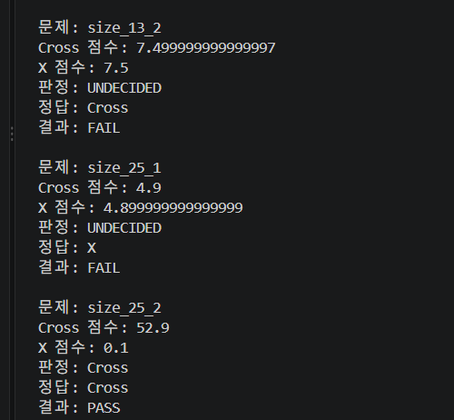
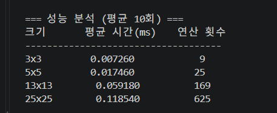
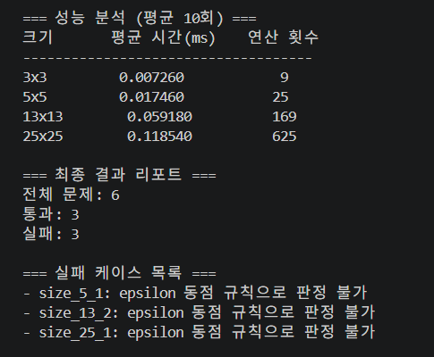

# Mini NPU Simulator

## 1. 프로젝트 소개

Python으로 2차원 배열과 MAC 연산을 구현해 패턴을 판별하고, 
JSON 데이터를 분석하며, 예외 처리와 성능 측정, GitHub 버전 관리까지 경험한 프로젝트입니다.

인공지능이 숫자로 패턴을 구별하는 방식을 간단하게 구현한 프로그램입니다. 
입력 패턴과 기준 필터를 MAC 연산으로 비교하고, 점수가 더 높은 필터를 선택해 십자가인지 X인지 판정합니다.

MAC(Multiply-Accumulate) 연산을 이용하여
입력 패턴이 십자가(Cross) 또는 X 중
어느 필터와 더 유사한지 판정합니다.

for 반복문은 왜 사용해야하는가
3×3이나 25×25처럼 숫자가 많은 행렬을 계산할 때 모든 계산을 직접 작성할 수 없기 때문에 반복문을 사용했습니다. 
이중 반복문으로 행과 열을 이동하면서 숫자를 곱하고 더했습니다.

if 조건문은 왜 필요한가
MAC 점수를 비교해서 어떤 필터가 더 높은지 결정하기 위해 사용했습니다. 
점수가 거의 같으면 판정 불가로 처리했습니다.

JSON 파일은 왜 사용한 이유
문제와 필터를 코드에 직접 작성하지 않고 별도의 파일에 저장하기 위해 사용했습니다. 
데이터와 프로그램을 분리하면 관리하기 쉽고 문제를 추가하기도 편리합니다.

왜 함수로 나눠서 만들었는가
MAC 계산, 점수 비교, 실행 시간 측정처럼 역할별로 함수를 분리하면 같은 코드를 반복 작성하지 않아도 되고, 
오류가 발생했을 때 수정하기 쉽기 때문입니다.

CPU와 NPU는 어떻게 다른걸까
CPU는 다양한 작업을 처리하는 범용 프로세서이고, 
NPU는 인공지능의 대량 행렬 연산을 효율적으로 수행하도록 설계된 프로세서입니다. 
제가 만든 프로그램은 실제 NPU가 아니라 Python으로 MAC 계산 원리를 흉내 낸 것입니다.

Git과 GitHub는 왜 사용했나
Git으로 코드를 수정한 과정을 커밋으로 기록하고, 
GitHub에 업로드해 프로젝트를 관리하고 공유했습니다. 
코드에 오류가 생겼을 때 변경 이력을 확인할 수도 있습니다.

## 2. 개발 환경

- 언어: Python 3.8 이상
- 개발 도구: Visual Studio Code
- 사용 라이브러리: json, time, pathlib
- 외부 라이브러리: 사용하지 않음

## 3. 실행 방법

1. main.py와 data.json을 같은 폴더에 저장합니다.
2. 터미널에서 다음 명령어를 실행합니다.

    python main.py

3. 실행 메뉴에서 원하는 기능을 선택합니다.

- 1번: 사용자 입력 (3×3)
- 2번: data.json 자동 분석
- 0번: 프로그램 종료

## 4. 구현 기능

1. 3×3 필터 A, B와 입력 패턴을 직접 입력할 수 있습니다.
2. 입력된 숫자의 개수와 자료형을 검사합니다.
3. MAC 연산으로 패턴과 필터의 유사도를 계산합니다.
4. 3×3, 5×5, 13×13, 25×25 배열을 처리합니다.
5. data.json에서 필터와 패턴을 읽습니다.
6. '+'와 'cross'는 Cross, 'x'는 X로 정규화합니다.
7. 두 점수의 차이가 1e-9 미만이면 UNDECIDED로 판정합니다.
8. JSON 문제별 PASS/FAIL을 출력합니다.
9. 오류가 발생한 문제의 이름과 실패 원인을 기록합니다.
10. MAC 연산을 10회 반복하여 평균 시간을 측정합니다.

## 5. 결과 리포트

### 5-1. JSON 자동 채점 결과

- 전체 테스트: 6개
- PASS: 3개
- FAIL: 3개

| 문제 | 판정 | 결과 |
|---|---|---|
| size_5_1 | UNDECIDED | FAIL |
| size_5_2 | Cross | PASS |
| size_13_1 | X | PASS |
| size_13_2 | UNDECIDED | FAIL |
| size_25_1 | UNDECIDED | FAIL |
| size_25_2 | Cross | PASS |

### 5-2. 실패 원인 분석

1. size_5_1은 Cross와 X의 MAC 점수가 거의 같아 FAIL이 발생했습니다.
2. size_13_2도 두 점수의 차이가 매우 작아 UNDECIDED로 판정되었습니다.
3. size_25_1 역시 epsilon 동점 처리 규칙으로 FAIL이 발생했습니다.
4. 세 문제 모두 예상 정답은 존재하지만, 계산된 점수는 동점 범위에 해당합니다.
5. 프로그램은 epsilon 값을 1e-9로 설정하여 작은 계산 오차를 처리합니다.
6. 부동소수점은 일부 소수를 정확하게 표현하지 못할 수 있습니다.
7. 따라서 두 점수의 미세한 차이만으로 우열을 판단하지 않도록 했습니다.
8. JSON에 저장된 '+'와 'x'는 각각 Cross와 X로 정규화했습니다.
9. 이를 통해 정답의 표기 차이로 발생할 수 있는 비교 오류를 방지했습니다.
10. 별도 크기 오류 테스트에서 5×5 패턴을 4줄로 수정했습니다.
11. 프로그램은 해당 문제를 크기 불일치로 FAIL 처리했습니다.
12. 나머지 문제는 중단 없이 계속 분석되었습니다.
13. 테스트 후 data.json을 원본으로 복원했습니다.
14. 따라서 관찰된 FAIL 3개는 데이터 크기 오류가 아닌 epsilon 동점 처리 정책에 따른 결과입니다.

### 5-3. 시간 복잡도 분석

MAC 연산은 2중 for 반복문으로 구현했습니다.

N×N 배열의 모든 위치를 한 번씩 계산하므로
곱셈 횟수는 N²번입니다.

| 배열 크기 | MAC 곱셈 횟수 |
|---|---|
| 3×3 | 9 |
| 5×5 | 25 |
| 13×13 | 169 |
| 25×25 | 625 |

따라서 MAC 연산의 시간 복잡도는 O(N²)입니다.

배열의 한 변 길이가 2배가 되면
처리해야 하는 데이터 개수는 약 4배가 됩니다.

실제 실행 시간은 컴퓨터의 성능과 실행 환경에 따라
달라질 수 있으므로 10회 반복 평균을 사용했습니다.

### 5-4. 실제 MAC 연산 성능 측정 결과

MAC 연산을 각 크기별로 10회 반복하여
평균 실행 시간을 측정했습니다.

| 크기 | 평균 시간(ms) | 연산 횟수(N²) |
|---|---:|---:|
| 3×3 | 0.005440 | 9 |
| 5×5 | 0.012480 | 25 |
| 13×13 | 0.048230 | 169 |
| 25×25 | 0.155620 | 625 |

### 성능 분석 결과

1. 3×3 배열의 평균 연산 시간은 0.005440ms였습니다.
2. 5×5 배열의 평균 연산 시간은 0.012480ms였습니다.
3. 13×13 배열의 평균 연산 시간은 0.048230ms였습니다.
4. 25×25 배열의 평균 연산 시간은 0.155620ms였습니다.
5. 배열 크기가 커질수록 연산 횟수가 증가했습니다.
6. 25×25 배열은 3×3 배열보다 약 69.4배 많은 곱셈이 필요합니다.
7. 실제 측정 시간은 약 28.6배 증가했습니다.
8. MAC 함수는 이중 반복문으로 모든 위치의 값을 계산합니다.
9. 따라서 연산 횟수는 N²에 비례합니다.
10. MAC 연산의 시간 복잡도는 O(N²)입니다.
11. 실제 실행 시간은 컴퓨터 환경과 측정 오차의 영향을 받습니다.
12. 이번 실험에서는 10회 반복 측정한 평균값을 사용했습니다.

## 6. 실행 결과 스크린샷

### 6-1. JSON 자동 채점 결과

data.json에 저장된 6개 문제를 분석하여
Cross/X 점수와 PASS/FAIL 결과를 확인했습니다.

**JSON 자동 채점 화면 1**

**JSON 자동 채점 화면 2**

**JSON 자동 채점 화면 3**

### 6-2. 최종 결과 및 성능 분석

전체 테스트 6개 중 PASS 3개, FAIL 3개로 확인되었습니다.

3개 실패 케이스는 epsilon 동점 처리 규칙에 따라
UNDECIDED로 판정되었습니다.

MAC 연산을 크기별로 10회 반복 측정하여
평균 연산 시간과 연산 횟수를 비교했습니다.

## 7. 평가 피드백 보완

### 7-1. normalize_label 함수 분리 이유

normalize_label 함수는 JSON 데이터의 정답 라벨을
일관된 형태로 변환하기 위해 별도로 구현했습니다.

예를 들어 "+"와 "cross"는 "Cross"로,
"x"는 "X"로 정규화합니다.

함수를 분리한 이유는 다음과 같습니다.

1. 중복 코드를 줄여 유지보수성을 높입니다.
2. 새로운 라벨이 추가되면 해당 함수만 수정할 수 있습니다.
3. 데이터 처리와 판정 로직의 역할을 분리합니다.

이를 통해 프로그램의 가독성과 확장성을 높였습니다.

### 7-2. MAC 실행 시간 측정 범위

measure_time 함수는 MAC 연산의 실행 시간을 측정하기 위해
동일한 연산을 10회 반복 수행합니다.

측정 구간에서는 mac(pattern, filter_data) 함수를 호출하며,
파일 읽기, 사용자 입력 및 결과 출력과 같은 I/O 작업은
측정 대상에서 제외합니다.

측정된 시간을 반복 횟수로 나누어 평균 실행 시간을 계산합니다.

이를 통해 입출력에 소요되는 시간의 영향을 줄이고
행렬 크기에 따른 MAC 연산 성능을 비교할 수 있습니다.

단, 측정 시간에는 Python 함수 호출과 반복문 실행에 따른
오버헤드가 포함되며, 운영체제 상태에 따라 결과가 달라질 수 있습니다.

### 7-3. 대형 행렬 처리 시 성능 문제와 최적화 방안

현재 프로그램은 5×5, 13×13, 25×25 크기의
JSON 패턴을 지원합니다.

향후 1000×1000 크기의 행렬로 확장할 경우
다음과 같은 성능 문제가 발생할 수 있습니다.

**1. 연산 시간 증가**

MAC 연산은 이중 반복문으로 구현되어 있으며,
시간 복잡도는 O(N²)입니다.

1000×1000 행렬은 원소가 1,000,000개이므로
MAC 계산 1회에 곱셈 1,000,000회와
이에 대응하는 누적 덧셈이 필요합니다.

25×25 행렬보다 곱셈 횟수가 1,600배 많아져
실행 시간이 증가할 수 있습니다.

**2. 메모리 사용량 증가**

행렬 크기가 증가할수록 저장해야 하는
데이터의 양도 O(N²)으로 증가합니다.

특히 Python의 중첩 리스트는 각 숫자의 객체 및
참조를 저장하기 위한 추가 메모리가 필요합니다.

입력 행렬과 필터를 동시에 저장하면
메모리 사용량이 더욱 증가합니다.

**3. 최적화 방안**

- 블록화: 큰 행렬을 작은 블록으로 나누어 처리하고
  캐시 활용 효율을 높입니다.
- 병렬화: 독립적인 곱셈 연산을 여러 연산 장치에서
  동시에 처리하도록 개선할 수 있습니다.
- NumPy 활용: 향후 배열 연산을 최적화된
  수치 계산 라이브러리로 수행할 수 있습니다.
- 데이터 타입 최적화: 필요한 정밀도에 맞는
  자료형을 사용하여 메모리 사용량을 줄일 수 있습니다.

**4. 우선 적용할 개선 방법**

현재 Python 이중 반복문 방식에서는
NumPy 기반 배열 연산으로 변경하는 방안을
우선 검토할 수 있습니다.

그다음 실제 성능 측정을 통해 블록화나
병렬화의 추가 효과를 확인할 수 있습니다.

단, 위 내용은 향후 확장을 위한 제안이며
현재 프로그램에 최적화 기능이 구현된 것은 아닙니다.

### 7-4. CPU와 NPU의 연산 방식 및 병목 비교

**1. CPU의 연산 방식**

CPU는 다양한 종류의 작업을 처리하는 범용 프로세서입니다.

현재 Mini NPU Simulator는 Python 이중 반복문으로
MAC 연산을 순차적으로 실행합니다.

행렬 크기가 커질수록 반복해야 하는 연산이 증가하여
실행 시간이 길어질 수 있습니다.

다만 CPU 자체도 멀티코어와 SIMD 명령어 등을 통해
병렬 연산을 수행할 수 있습니다.

**2. NPU의 연산 방식**

NPU(Neural Processing Unit)는 인공지능 연산에
특화된 프로세서입니다.

여러 연산 장치를 활용하여 대량의 곱셈 및 누적 연산을
병렬로 처리할 수 있도록 설계됩니다.

따라서 적절한 연산 구조와 데이터 크기에서는
CPU보다 높은 처리 효율을 얻을 수 있습니다.

**3. CPU와 NPU의 병목 차이**

| 구분 | CPU | NPU |
|---|---|---|
| 주요 목적 | 범용 연산 처리 | AI 행렬·텐서 연산 |
| 연산 방식 | 순차 및 병렬 처리 | 대규모 병렬 연산에 특화 |
| 주요 병목 | 반복문 실행, 메모리 접근 등 | 데이터 전송, 메모리 대역폭, 연산 장치 활용률 등 |
| 강점 | 다양한 작업과 복잡한 제어 처리 | 대량의 반복적인 MAC 연산 처리 |

**4. 대형 MAC 연산에서의 차이**

1000×1000 행렬의 MAC 계산에는
1,000,000회의 곱셈과 누적 덧셈이 필요합니다.

현재 Python 구현에서는 이중 반복문을 통해
각 원소의 계산을 차례대로 수행합니다.

NPU는 이러한 연산 중 독립적으로 수행할 수 있는
부분을 여러 연산 장치에 분산하여 처리할 수 있습니다.

단, 데이터 전송량이나 메모리 대역폭이 부족하면
연산 장치가 충분히 활용되지 못할 수 있습니다.

**5. 프로젝트와의 연관성**

본 프로젝트는 실제 NPU 하드웨어를 사용하지 않고
Python으로 MAC 연산의 원리를 시뮬레이션합니다.

따라서 현재 측정 결과는 Python 프로그램의
실행 시간이며 실제 CPU와 NPU의 성능 비교 결과는 아닙니다.

향후 CPU 최적화 구현과 NPU 실행 환경을 각각 측정하면
연산 시간과 병목 현상을 비교할 수 있습니다.

### 7-5. 사용자 모드 판정 문구 개선

사용자 입력 모드에서는 두 MAC 점수의 차이가
epsilon(1e-9)보다 작으면 "판정 불가"를 출력합니다.

JSON 자동 채점 모드에서는 동일한 상황에
"UNDECIDED"를 출력하도록 구분했습니다.

판정 함수의 내부 반환값은 유지하면서
사용자에게 표시하는 문구만 변경했습니다.

동일한 3x3 필터를 입력하여 두 점수가 5.0으로
같아졌을 때 "판정 불가"가 출력되는 것을 확인했습니다.

### 7-6. JSON 필터 키 정규화 기능 개선

기존에는 JSON 필터 키가 "cross"와 "x"인 경우만
정상적으로 처리할 수 있었습니다.

이를 개선하여 다음 표기를 인식하도록 수정했습니다.

- Cross 필터: "cross", "Cross", "+"
- X 필터: "x", "X"

JSON 자동 채점과 성능 분석에 모두 적용했습니다.

테스트 과정에서 "Cross"와 "+" 표기로 변경한 후에도
전체 6개 문제의 결과가 유지되는 것을 확인했습니다.

- 전체 문제: 6개
- PASS: 3개
- FAIL: 3개
- 성능 분석: 3x3, 5x5, 13x13, 25x25 정상 실행

테스트 이후 data.json은 원본으로 복원했습니다.
