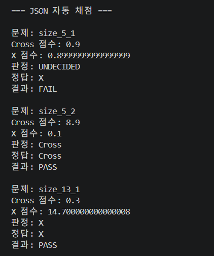

# Mini NPU Simulator

## 1. 프로젝트 소개

Mini NPU Simulator는 Python으로 구현한
인공지능 패턴 인식 시뮬레이터입니다.

MAC(Multiply-Accumulate) 연산을 이용하여
입력 패턴이 십자가(Cross) 또는 X 중
어느 필터와 더 유사한지 판정합니다.

## 2. 개발 환경

- 언어: Python 3.8 이상
- 개발 도구: Visual Studio Code
- 사용 라이브러리: json, time, pathlib
- 외부 라이브러리: 사용하지 않음

## 3. 실행 방법

1. main.py와 data.json을 같은 폴더에 저장합니다.
2. 터미널에서 다음 명령어를 실행합니다.

    python main.py

3. 실행 메뉴에서 원하는 기능을 선택합니다.

- 1번: 사용자 입력 (3×3)
- 2번: data.json 자동 분석
- 0번: 프로그램 종료

## 4. 구현 기능

1. 3×3 필터 A, B와 입력 패턴을 직접 입력할 수 있습니다.
2. 입력된 숫자의 개수와 자료형을 검사합니다.
3. MAC 연산으로 패턴과 필터의 유사도를 계산합니다.
4. 3×3, 5×5, 13×13, 25×25 배열을 처리합니다.
5. data.json에서 필터와 패턴을 읽습니다.
6. '+'와 'cross'는 Cross, 'x'는 X로 정규화합니다.
7. 두 점수의 차이가 1e-9 미만이면 UNDECIDED로 판정합니다.
8. JSON 문제별 PASS/FAIL을 출력합니다.
9. 오류가 발생한 문제의 이름과 실패 원인을 기록합니다.
10. MAC 연산을 10회 반복하여 평균 시간을 측정합니다.

## 5. 결과 리포트

### 5-1. JSON 자동 채점 결과

- 전체 테스트: 6개
- PASS: 3개
- FAIL: 3개

| 문제 | 판정 | 결과 |
|---|---|---|
| size_5_1 | UNDECIDED | FAIL |
| size_5_2 | Cross | PASS |
| size_13_1 | X | PASS |
| size_13_2 | UNDECIDED | FAIL |
| size_25_1 | UNDECIDED | FAIL |
| size_25_2 | Cross | PASS |

### 5-2. 실패 원인 분석

1. size_5_1은 Cross와 X의 MAC 점수가 거의 같아 FAIL이 발생했습니다.
2. size_13_2도 두 점수의 차이가 매우 작아 UNDECIDED로 판정되었습니다.
3. size_25_1 역시 epsilon 동점 처리 규칙으로 FAIL이 발생했습니다.
4. 세 문제 모두 예상 정답은 존재하지만, 계산된 점수는 동점 범위에 해당합니다.
5. 프로그램은 epsilon 값을 1e-9로 설정하여 작은 계산 오차를 처리합니다.
6. 부동소수점은 일부 소수를 정확하게 표현하지 못할 수 있습니다.
7. 따라서 두 점수의 미세한 차이만으로 우열을 판단하지 않도록 했습니다.
8. JSON에 저장된 '+'와 'x'는 각각 Cross와 X로 정규화했습니다.
9. 이를 통해 정답의 표기 차이로 발생할 수 있는 비교 오류를 방지했습니다.
10. 별도 크기 오류 테스트에서 5×5 패턴을 4줄로 수정했습니다.
11. 프로그램은 해당 문제를 크기 불일치로 FAIL 처리했습니다.
12. 나머지 문제는 중단 없이 계속 분석되었습니다.
13. 테스트 후 data.json을 원본으로 복원했습니다.
14. 따라서 관찰된 FAIL 3개는 데이터 크기 오류가 아닌 epsilon 동점 처리 정책에 따른 결과입니다.

### 5-3. 시간 복잡도 분석

MAC 연산은 2중 for 반복문으로 구현했습니다.

N×N 배열의 모든 위치를 한 번씩 계산하므로
곱셈 횟수는 N²번입니다.

| 배열 크기 | MAC 곱셈 횟수 |
|---|---|
| 3×3 | 9 |
| 5×5 | 25 |
| 13×13 | 169 |
| 25×25 | 625 |

따라서 MAC 연산의 시간 복잡도는 O(N²)입니다.

배열의 한 변 길이가 2배가 되면
처리해야 하는 데이터 개수는 약 4배가 됩니다.

실제 실행 시간은 컴퓨터의 성능과 실행 환경에 따라
달라질 수 있으므로 10회 반복 평균을 사용했습니다.

### 5-4. 실제 MAC 연산 성능 측정 결과

MAC 연산을 각 크기별로 10회 반복하여
평균 실행 시간을 측정했습니다.

| 크기 | 평균 시간(ms) | 연산 횟수(N²) |
|---|---:|---:|
| 3×3 | 0.005440 | 9 |
| 5×5 | 0.012480 | 25 |
| 13×13 | 0.048230 | 169 |
| 25×25 | 0.155620 | 625 |

### 성능 분석 결과

1. 3×3 배열의 평균 연산 시간은 0.005440ms였습니다.
2. 5×5 배열의 평균 연산 시간은 0.012480ms였습니다.
3. 13×13 배열의 평균 연산 시간은 0.048230ms였습니다.
4. 25×25 배열의 평균 연산 시간은 0.155620ms였습니다.
5. 배열 크기가 커질수록 연산 횟수가 증가했습니다.
6. 25×25 배열은 3×3 배열보다 약 69.4배 많은 곱셈이 필요합니다.
7. 실제 측정 시간은 약 28.6배 증가했습니다.
8. MAC 함수는 이중 반복문으로 모든 위치의 값을 계산합니다.
9. 따라서 연산 횟수는 N²에 비례합니다.
10. MAC 연산의 시간 복잡도는 O(N²)입니다.
11. 실제 실행 시간은 컴퓨터 환경과 측정 오차의 영향을 받습니다.
12. 이번 실험에서는 10회 반복 측정한 평균값을 사용했습니다.

## 6. 실행 결과 스크린샷

### 6-1. JSON 자동 채점 결과

data.json에 저장된 6개 문제를 분석하여
Cross/X 점수와 PASS/FAIL 결과를 확인했습니다.

**JSON 자동 채점 화면 1**

**JSON 자동 채점 화면 2**

**JSON 자동 채점 화면 3**

### 6-2. 최종 결과 및 성능 분석

전체 테스트 6개 중 PASS 3개, FAIL 3개로 확인되었습니다.

3개 실패 케이스는 epsilon 동점 처리 규칙에 따라
UNDECIDED로 판정되었습니다.

MAC 연산을 크기별로 10회 반복 측정하여
평균 연산 시간과 연산 횟수를 비교했습니다.

